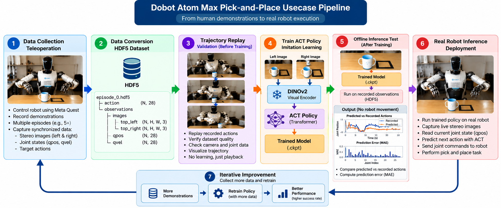

# DOBOT ATOM MAX — Policy Training Pipeline



**Workflow:** Meta Quest teleoperation → raw `.jpg` + `.pkl` recordings → HDF5 → ACT training → offline test → real-robot inference.


## Table of Contents
1. [PC2 setup](#1-pc2-setup)
2. [Teleoperation and recording](#2-teleoperation-and-recording)
3. [Convert demonstrations to HDF5](#3-convert-demonstrations-to-hdf5)
4. [Verify the dataset](#4-verify-the-dataset)
5. [Train ACT](#5-train-act)
6. [Test inference offline](#6-test-inference-offline)
7. [Prepare real-robot inference](#7-prepare-real-robot-inference)
8. [Run real-robot inference](#8-run-real-robot-inference)
9. [Code fixes that made inference work](#9-code-fixes-that-made-inference-work)
10. [Result and next step](#10-result-and-next-step)
11. [Optional diagnostics](#11-optional-diagnostics)

## 1. PC2 setup
**Description:** Open a terminal on robot PC2, activate the `Atom` environment, and go to the vendor training directory.

```bash
conda activate Atom
cd "/home/dobotpc2/ATOM_train_1.0.2.0_stable_30f29f5f_pc1v110beta9_20260323 (1)/ATOM_train_1.0.2.0_stable_30f29f5f_pc1v110beta9_20260323/ATOM_train"
```

All `python script/...` commands below run from this **ATOM_train root directory**, unless otherwise specified.

## 2. Teleoperation and recording
**Description:** Use Meta Quest teleoperation to record 5 successful cup/bottle pick-and-place demonstrations.

**Steps**
1. Put the ATOM MAX in the supported operating mode and prepare the table, object, and black target rectangle.
2. On PC2, start the DOBOT teleoperation application; set the head stereo camera index if needed.
3. Connect Meta Quest to the robot's VR teleoperation interface.
4. Enable teleoperation, trigger **Record On**, perform the task, then trigger **Record Off**.
5. Repeat until **5 episodes** are collected.

**Teleoperation launcher commands from the DOBOT user guide** (the exact launcher filename on your PC2 was not captured in the provided terminal logs; run these only if the files exist in your installed teleoperation directory):

```bash
cd ~/ATOM/ATOM_teleoperate
ls -1 *.sh
# Guide lists the following launchers:
./set_top_camera.sh
./run__teleop.sh
```

**Raw recording folder used:**

```text
/home/dobotpc2/ATOM/ATOM_teleoperate/new_dataset/
└── collect_data/
    └── <episode_timestamp>/
        ├── observation/   # 0.pkl, 1.pkl, ... (28-D obs + action)
        ├── top_left/      # 0.jpg, 1.jpg, ...
        ├── top_right/     # 0.jpg, 1.jpg, ...
        └── trajectory.txt
```

## 3. Convert demonstrations to HDF5
**Description:** Convert recorded images and joint data into `.hdf5` episodes for ACT training.

From the **ATOM_train root**:

```bash
python script/o1_collect2train_data.py \
  --src_dataset_path /home/dobotpc2/ATOM/ATOM_teleoperate/new_dataset \
  --camera_names top_left top_right
```

**Output:**

```text
/home/dobotpc2/ATOM/ATOM_teleoperate/new_dataset/train_data/
├── episode_0.hdf5
├── episode_1.hdf5
├── episode_2.hdf5
├── episode_3.hdf5
└── episode_4.hdf5
```

*The `o1` flags above were verified against the vendor script; the exact original terminal invocation was not preserved.*

## 4. Verify the dataset
**Description:** Confirm that the converted file contains the stereo images, robot states, and 28-D actions.

```bash
python - <<'PY'
import h5py
p = '/home/dobotpc2/ATOM/ATOM_teleoperate/new_dataset/train_data/episode_0.hdf5'
with h5py.File(p, 'r') as f:
    print('Frames:', len(f['action']))
    print('Action shape:', f['action'].shape)
    print('QPOS shape:', f['observations/qpos'].shape)
    print('QVEL shape:', f['observations/qvel'].shape)
    print('Cameras:', list(f['observations/images'].keys()))
PY
```

**Verified example:** `episode_0.hdf5` has **1,239 frames**; `action` and `qpos` are `(1239, 28)`.

**28-D order:** left arm 7 + left fingers 6 + right arm 7 + right fingers 6 + head 2.

## 5. Train ACT
**Description:** Train the ACT imitation-learning policy on the converted demonstrations and save checkpoints.

```bash
python script/o2_model_train.py \
  --task_name test_task1 \
  --ckpt_dir ModelTrain/ckpt/bottle_pick_place \
  --num_steps 5000 \
  --batch_size 8 \
  --validate_every 500 \
  --save_every 1000
```

**Checkpoint used:**

```text
ModelTrain/ckpt/bottle_pick_place/policy_best.ckpt
```

## 6. Test inference offline
**Description:** Run ACT on recorded HDF5 observations and compare predictions with recorded actions; the robot does not move.

```bash
python script/o3_model_inference_test.py \
  --testdata_h5_path /home/dobotpc2/ATOM/ATOM_teleoperate/new_dataset/train_data/episode_0.hdf5 \
  --model_path ModelTrain/ckpt/bottle_pick_place \
  --model_name policy_best.ckpt \
  --camera_names top_left top_right
```

**Output:** prediction plots and prediction error (MAE); the offline test ran successfully.

*The `o3` flags were verified against the vendor script; this is the matching command for your paths.*

## 7. Prepare real-robot inference
**Description:** Detect the currently assigned stereo camera ID and check the corrected inference script.

```bash
python script/find_top_camera.py
```

**Last detected camera ID:** `12` (`720 × 2560` stereo frame). It was previously `18`; **use the ID reported on the current boot**.

Confirm your edited script compiles:

```bash
python -m py_compile script/o4_run_inference_poc.py
```

**Important:** `o4_run_inference_poc.py` is your working edited copy; the unmodified `o4_run_inference.py` still contains the earlier control problems.

## 8. Run real-robot inference
**Description:** Load `policy_best.ckpt`, read live stereo images and measured joints, and execute the learned policy on ATOM MAX.

**Physical robot command — only with the two code fixes in Section 9 and your supervised robot-test setup:**

```bash
python -u script/o4_run_inference_poc.py \
  --h5_path /home/dobotpc2/ATOM/ATOM_teleoperate/new_dataset/train_data/episode_0.hdf5 \
  --model_path ModelTrain/ckpt/bottle_pick_place \
  --model_name policy_best.ckpt \
  --camera_names top_left top_right \
  --top_camera_id 12 \
  2>&1 | tee ~/inference_test.log
```

`12` is an **example from the latest camera-detection run**; replace it if `find_top_camera.py` reports another ID.

The script prints `Model loaded`, `Starting autonomous operation`, and `Total cycle time: ~0.050s` (approximately **20 Hz**).

## 9. Code fixes that made inference work
**Description:** Correct the arm velocity timing and feed ACT the measured joint state instead of its previous commanded action.

**File:** `script/o4_run_inference_poc.py`

### Fix A — velocity timing (original line ~254)

**Before:**

```python
arm_velocity = (target_arm - arm_state) / (time.time() - cycle_start)
```

**After:**

```python
arm_velocity = (target_arm - arm_state) / (config.cycle_time / 1000.0)
```

**Observed result:** The previous right-arm **J6 alarm did not recur** during the subsequent supervised inference runs. Exact servo fault cause remains unconfirmed.

### Fix B — actual `qpos` feedback (original line ~226)

**Before:**

```python
observation['qpos'] = last_action.copy()
```

**After:**

```python
current_arm, current_hand, current_head = robot.get_joint_state()
observation['qpos'] = np.concatenate([
    current_arm[0:7], current_hand[0:6],
    current_arm[7:14], current_hand[6:12],
    current_head
])
```

**Observed result:** The robot started meaningful grasp/placement behavior after receiving **measured joint states**, consistent with training observations.

**Note:** The script still needs a reviewed first-action movement guard before production deployment.

## 10. Result and next step
**Description:** The end-to-end learning pipeline is proven, but unassisted table pickup is not yet reliable.

- **Achieved:** Teleoperation → HDF5 → ACT training → offline inference → real-robot inference → **grasping a hand-presented cup and placing it in the black rectangle**.
- **Not yet achieved:** Reliable **autonomous approach, table pickup, and grasp**.
- **Next:** Preserve the working code/checkpoint, measure fixed-scene success, collect ~20–30 **complete table-pick demonstrations**, retrain, and compare success rates. Five episodes were sufficient for a proof of concept, not yet for demonstrated reliability.

## 11. Optional diagnostics
**Description:** Inspect inference behavior or replay a recorded trajectory without retraining.

**View live inference output:**

```bash
tail -40 ~/inference_test.log
```

**Verify key code lines:**

```bash
grep -nE 'arm_velocity =|dynamic_approach|check_pose_protection|observation\[.qpos.\]' script/o4_run_inference_poc.py
```

**Replay a recorded teleoperation trajectory** (the trajectory file path must first be configured inside `replay_trajectory.py`; this is a **physical motion** command):

```bash
cd ~/ATOM/ATOM_teleoperate/script
conda activate Atom
python replay_trajectory.py
```

**Do not use the offline test as evidence of successful physical grasping; measure success on the robot.**
